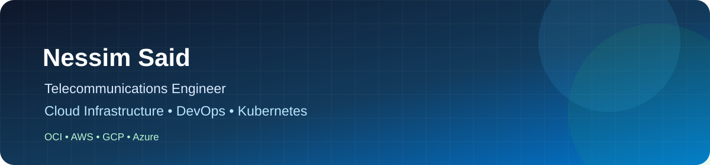

 

  

<h1 align="center">Nessim Said</h1>

<h3 align="center">Cloud Infrastructure & DevOps Engineer</h3>

  <a href="mailto:nessimsaid22@gmail.com">Email</a> ·
  <a href="https://www.linkedin.com/in/nessim-said/">LinkedIn</a> ·
  <a href="https://github.com/nessim141">GitHub</a> ·
  Nabeul, Tunisia

  
  
  
  

---

## About Me

I'm a Telecommunications Engineer specializing in **Cloud Infrastructure and DevOps**, with hands-on experience designing, deploying, and automating cloud-native environments.

My work focuses on building reliable and secure infrastructure through Infrastructure as Code, container orchestration, CI/CD automation, and observability.

I have worked with multiple cloud environments, including **Oracle Cloud Infrastructure, AWS, Google Cloud, and Azure**, and enjoy exploring distributed systems, Kubernetes ecosystems, and infrastructure automation.

Currently interested in opportunities in:

- Cloud Engineering & Infrastructure
- DevOps & Platform Engineering
- Kubernetes & Cloud-Native Technologies
- Infrastructure Automation & GitOps
- Linux Systems Administration

---

## Technical Skills

### Cloud & Infrastructure

  

OCI · OKE · GKE · Cloud Infrastructure · Infrastructure as Code

### Containers & Orchestration

  

Docker · Kubernetes · Helm · Container Networking

### CI/CD & GitOps

  

Jenkins · GitHub Actions · Argo CD · GitOps

### Monitoring & Observability

  

Prometheus · Grafana · Nagios · Infrastructure Monitoring

### Systems, Networking & Development

  

Linux Administration · Bash · Python · Java · Spring Boot · REST APIs

**Networking & Security:** TCP/IP · DNS · DHCP · SNMP · OpenLDAP · SSH

---

## Featured Projects

### 01. DNS Infrastructure & TLS Automation

**Cloud Infrastructure | Kubernetes | Terraform**

Automated infrastructure provisioning and DNS/TLS management across OCI and GCP Kubernetes environments.

- Infrastructure provisioning with Terraform.
- Automated DNS management using ExternalDNS.
- TLS certificate issuance and renewal using cert-manager.
- CI/CD automation with Jenkins.
- Kubernetes deployment and monitoring.

[View Project →](https://github.com/nessim141/oci-oke)

### 02. Sovereign AI Platform

**DevOps | Kubernetes | GitOps | Infrastructure Automation**

Working on a cloud-native platform designed to deploy and manage AI workloads on sovereign infrastructure.

- Infrastructure provisioning with Terraform.
- Kubernetes cluster deployment using K3s.
- GitOps workflows with Argo CD.
- AI workload deployment with KubeAI.
- Monitoring using Prometheus and Grafana.

[View Project →](https://github.com/BhivesAI/ai-platform-core)

### 03. Java Development Portfolio

**Java | JavaFX | Databases**

A collection of Java applications demonstrating object-oriented programming, desktop development, and database integration.

[View Project →](https://github.com/nessim141/Java_projects)

### 04. Sysfoo

**Spring Boot | Java | REST APIs**

A Spring Boot application combining system information management and task-list functionality.

[View Project →](https://github.com/nessim141/sysfoo)

### 05. Argo CD for Beginners

**Kubernetes | GitOps | Continuous Delivery**

A practical introduction to GitOps principles and continuous application delivery using Argo CD.

[View Project →](https://github.com/nessim141/Argo-CD-for-the-Absolute-Beginners)

---

## Certifications

  
  
  
  

---

## Education

**National Engineering Degree in Telecommunications**  
ENETCOM, Sfax · 2023–2026

**Preparatory Classes in Mathematics and Physics**  
IPEIN, Nabeul · 2021–2023

---

## GitHub Statistics

  
  

  

---

## Languages

- Arabic — Native
- French — B2
- English — B2

---

  <strong>Building, automating, and improving cloud infrastructure.</strong>

  <a href="mailto:nessimsaid22@gmail.com">Let's connect</a>

